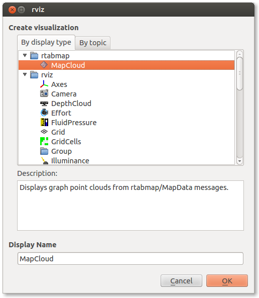

# rtabmap_rviz_plugins

[RViz](https://github.com/ros2/rviz) displays for [RTAB-Map](https://github.com/introlab/rtabmap) topics: the map cloud rebuilt from the graph, the graph itself, the SLAM statistics, and a view controller that follows the robot.

There are no nodes here. The plugins are loaded by RViz: **Add** → **By display type** → `rtabmap_rviz_plugins`, or by topic with **Add** → **By topic**. [`rtabmap_launch`](https://github.com/introlab/rtabmap_ros/tree/ros2/rtabmap_launch)'s `rgbd.rviz` and the [`rtabmap_demos`](https://github.com/introlab/rtabmap_ros/tree/ros2/rtabmap_demos) configs use them, and are a good starting point.

## Contents

- [Plugins](#plugins)
- [MapCloud](#mapcloud)
- [MapGraph](#mapgraph)
- [Info](#info)
- [OrbitOriented](#orbitoriented)
- [License](#license)

## Plugins

| Plugin | Type | Description |
|---|---|---|
| [`rtabmap_rviz_plugins/MapCloud`](#mapcloud) | Display | 3D map built incrementally from `mapData`, re-positioned whenever the graph is optimized. |
| [`rtabmap_rviz_plugins/MapGraph`](#mapgraph) | Display | The graph, links colored by type. |
| [`rtabmap_rviz_plugins/Info`](#info) | Display | Loop closures and statistics of the last update, in the display's status. |
| [`rtabmap_rviz_plugins/OrbitOriented`](#orbitoriented) | View controller | Orbit camera turning with the target frame's yaw, optionally kept in front of walls. |

## MapCloud

Subscribes to `mapData` ([`rtabmap_msgs/msg/MapData`](https://docs.ros.org/en/jazzy/p/rtabmap_msgs/msg/MapData.html)), published by the [`rtabmap`](https://github.com/introlab/rtabmap_ros/blob/ros2/rtabmap_slam/doc/rtabmap.md) node. Each message carries the whole graph but only the sensor data of the new nodes: the display creates one cloud per node from that data and keeps it, then moves every cloud to its node's latest pose. When loop closures change the graph, the whole map follows without anything being downloaded again.

This is the cheap way to watch a map grow on a remote computer: only the new nodes cross the network, and the clouds are generated on the RViz side. Compared to subscribing to the `rtabmap` node's `cloud_map`, the map is never re-assembled and re-sent as a whole.

It renders like the standard [PointCloud2](https://docs.ros.org/en/jazzy/p/rviz_default_plugins/) display, with the same `Style`, `Size (m)`, `Size (Pixels)`, `Alpha`, `Position Transformer` and `Color Transformer` properties, plus these:

| Property | Default | Range | Description |
|---|---|---|---|
| `Cloud from scan` | `false` | | Create the clouds from the nodes' laser scans instead of their RGB-D or stereo images. Changing it clears the display. |
| `Cloud decimation` | `4` | 1 to 16 | Decimation of the RGB and depth images before creating the cloud. |
| `Cloud max depth (m)` | `4.0` | 0 to 999 | Maximum depth of the points kept. `0` means no limit. |
| `Cloud min depth (m)` | `0.0` | 0 to 999 | Minimum depth of the points kept. |
| `Cloud voxel size (m)` | `0.01` | 0 to 1 | Voxel size of each node's cloud. `0` disables the voxel filter. |
| `Filter floor (m)` | `0.0` | -999 to 999 | Remove points below this height. Only appropriate for 2D mapping. `0` disables. |
| `Filter ceiling (m)` | `0.0` | -999 to 999 | Remove points above this height. Only appropriate for 2D mapping. `0` disables. |
| `Node filtering radius (m)` | `0.0` | 0 to 10 | Only show one node in this radius. `0` disables. |
| `Node filtering angle (degrees)` | `30.0` | 0 to 359 | With `Node filtering radius (m)`, only nodes that also differ by less than this angle are merged. `0` disables. |
| `Download namespace` | `rtabmap` | | Namespace of the `rtabmap` node, used by the two properties below and for `republish_node_data`. |
| `Download map` | `false` | | Check it to call `<namespace>/get_map_data` for the whole optimized map, including sensor data, and re-create every cloud. Can take a while on a big map. |
| `Download graph` | `false` | | The same without the sensor data: only the poses are updated. |

The cloud properties only apply to the clouds created after they change: download the map to regenerate the ones already shown.

**Joining a map late.** RViz started after `rtabmap` receives the graph but not the data of the nodes already mapped. The display asks for it by publishing the missing node ids on `<namespace>/republish_node_data` ([`std_msgs/msg/Int32MultiArray`](https://docs.ros.org/en/jazzy/p/std_msgs/msg/Int32MultiArray.html)), and `rtabmap` includes them in the next `mapData`. For a large map, `Download map` gets everything at once.

**Fixed frame.** The poses in `mapData` are in the map frame (`map` by default): set it, or a frame TF can relate to it, as RViz's fixed frame, otherwise the clouds are not shown and the display reports the transform error.

## MapGraph

Subscribes to `mapGraph` ([`rtabmap_msgs/msg/MapGraph`](https://docs.ros.org/en/jazzy/p/rtabmap_msgs/msg/MapGraph.html)), published by the `rtabmap` node, and draws the graph's links as lines, colored by link type.

| Property | Default | Description |
|---|---|---|
| `Neighbor` | blue | Odometry links between consecutive nodes. |
| `Merged neighbor` | orange | Neighbor links merged when the nodes between them were removed from the graph (e.g., with `Mem/ReduceGraph`). |
| `Global loop closure` | red | Loop closures found by appearance, and any other link type. |
| `Local loop closure` | yellow | Proximity detections. |
| `Landmark` | dark green | Links to landmarks (e.g., AprilTags, ArUco markers). |
| `User` | red | Links added by the user. |
| `Virtual` | magenta | Virtual links. |
| `Alpha` | `1.0` | Transparency of the lines. |

## Info

Subscribes to `info` ([`rtabmap_msgs/msg/Info`](https://docs.ros.org/en/jazzy/p/rtabmap_msgs/msg/Info.html)), published by the `rtabmap` node after each update, and shows it in the display's status rather than in the 3D view:

| Status | Content |
|---|---|
| `Info` | Loop closure of the last update (`<node id>-><loop closure id>`), or proximity detection (suffixed with `[Proximity]`). Empty if there was none. |
| `Position (XYZ)`, `Orientation (RPY)` | Transform of that loop closure. |
| `Loop closures` | Number of loop closures since the display started. |
| `Proximity detections` | Number of proximity detections since the display started. |
| others | Every statistic of the last update (timings, memory, ...), by name. |

Resetting the display clears the counts.

## OrbitOriented

A view controller (**Views** panel → **Type**) behaving like RViz's `Orbit`, except that the camera turns with the yaw of the target frame: with `Target Frame` set to the robot's base frame, the view stays behind the robot as it turns, and level when it tilts. It has the `Orbit` properties plus:

| Property | Default | Description |
|---|---|---|
| `Field of View` | `0.785` | Vertical field of view of the camera, in radians. |
| `Wall clipping` | `false` | Move the camera in front of the octomap obstacles that would hide the target. Requires the package to be built with `octomap` and `octomap_msgs`; read-only otherwise. |
| `Wall clipping` → `Octomap Topic` | `/octomap_binary` | Octomap ([`octomap_msgs/msg/Octomap`](https://docs.ros.org/en/jazzy/p/octomap_msgs/msg/Octomap.html)) in which obstacles are looked for, e.g., `rtabmap`'s `octomap_binary` (occupancy only, smaller) or `octomap_full`. |
| `Wall clipping` → `Ignore Distance` | `1.0` | Obstacles closer than this to the focal point, in meters, are ignored, so that the target's own voxels do not count. |
| `Wall clipping` → `Octree Depth` | `16` | Depth of the octomap at which obstacles are looked for. Set it as the octomap display's `Max. Octree Depth`, so that the camera stops in front of the cubes shown. `16` is the full resolution. |
| `Wall clipping` → `Wall Margin` | `0.05` | How far in front of an obstacle the camera is put, in meters. |

The octomap is decoded in a background thread, keeping only the latest one, so a large map does not stall RViz. `rtabmap` only publishes `octomap_binary` when subscribed and when RTAB-Map is built with OctoMap.

**Example.** The [Netherdrone 3D LiDAR SLAM](https://github.com/introlab/rtabmap_ros/tree/ros2/rtabmap_demos#netherdrone-3d-lidar-slam) demo ([video](https://youtu.be/ytsfhMdv9W0)) maps an indoor climbing facility with a drone, using this view controller with wall clipping enabled: the camera follows the drone from behind and moves in front of the walls that would otherwise hide it. Its RViz config, [`demo_lidar3d.rviz`](https://github.com/introlab/rtabmap_ros/blob/ros2/rtabmap_demos/config/demo_lidar3d.rviz), sets `Octree Depth` to `14` to match the octomap display.

## License

BSD-3-Clause. See the [repository root](https://github.com/introlab/rtabmap_ros#license).
